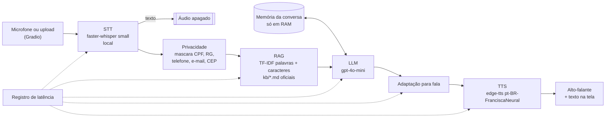

# Zelo: assistente de voz para zeladoria urbana

FIAP, Global Solution 2026.2 (CitizenTech), turma 2TIAPY
Disciplina: Processamento de Linguagem Natural, Chatbots & Virtual Agents

| Integrante | RM |
|---|---|
| Gabriel Palmeira | 563522 |
| Mayara Mota | 563887 |

O Zelo é um assistente de voz em português para quem tem dificuldade com aplicativos e sites. O cidadão fala, o Zelo entende o pedido com um LLM apoiado em informações oficiais da Prefeitura de São Paulo e responde falando. Ele explica como pedir tapa-buraco, conserto de iluminação, poda de árvore, descarte de entulho, Cata-Bagulho, limpeza de bueiro, alertas de chuva e remoção de veículo abandonado.

* **Persona:** Dona Cida, 68 anos, moradora de Itaquera, enxerga pouco e não usa aplicativos. O poste da rua dela está apagado e ela não sabe a quem pedir o conserto.


* **Vídeo da demonstração:** https://youtu.be/28jB8UT0IAw
* **Relatório:** [`docs/relatorio_zelo.pdf`](docs/relatorio_zelo.pdf)

## Arquitetura



Cada etapa é um módulo separado e pode ser trocada sem mexer no resto:

| Módulo | Arquivo | Função |
|---|---|---|
| Interface e captura | `app.py` | Gradio com botão de falar, upload de áudio, termo de consentimento, transcrição e resposta em texto, latência e fontes |
| STT | `zelo/stt.py` | faster-whisper local em português, com vocabulário do domínio |
| Privacidade | `zelo/privacy.py` | consentimento, mascaramento de dados pessoais, exclusão do áudio, detector de emergência |
| Base de conhecimento | `zelo/knowledge.py`, `kb/` | 9 documentos escritos a partir de páginas oficiais, com a fonte no topo de cada um |
| Diálogo | `zelo/pipeline.py`, `zelo/prompts.py`, `zelo/llm.py` | memória da conversa, system prompt com papel, tom e limites |
| Adaptação para fala | `zelo/speech_adapter.py` | tira markdown, emoji e links; escreve números, telefones, datas e siglas de forma pronunciável |
| TTS | `zelo/tts.py` | voz neural pt-BR, com a voz Luciana do macOS como reserva sem internet |
| Latência | `zelo/latency.py` | tempo de cada etapa, gravado sem o conteúdo da conversa |

O áudio é transcrito no próprio computador e apagado em seguida. Só texto vai para a nuvem: a pergunta, com dados pessoais mascarados, vai para a OpenAI, e a resposta vai para o serviço de voz.

## Modelos e bibliotecas

| Componente | Modelo ou biblioteca | Versão | Licença |
|---|---|---|---|
| STT | Whisper small (`Systran/faster-whisper-small`) | faster-whisper 1.2.1 | MIT |
| STT, comparação | Whisper base (`Systran/faster-whisper-base`) | faster-whisper 1.2.1 | MIT |
| LLM | OpenAI gpt-4o-mini (snapshot `gpt-4o-mini-2024-07-18`) | SDK openai 3.54.0 | Termos de uso da OpenAI (SDK Apache 2.0) |
| TTS | Microsoft pt-BR-FranciscaNeural via edge-tts | edge-tts 7.3.1 | LGPL-3.0 (voz sintética pronta, sem clonagem) |
| Interface | Gradio | 6.32.0 | Apache 2.0 |
| Busca | scikit-learn (TF-IDF) | 1.9.1 | BSD-3-Clause |
| Números por extenso | num2words | 0.5.14 | LGPL-2.1 |
| WER | jiwer | 4.0.0 | Apache 2.0 |

## Como rodar

Precisa de Python 3.10 ou superior (testado com 3.14 num MacBook Air), internet e uma chave da OpenAI. Não precisa de GPU nem de Docker.

```bash
cd zelo-voz
python3 -m venv .venv
source .venv/bin/activate
pip install -r requirements.txt
cp .env.example .env          # abra o .env e cole a sua OPENAI_API_KEY
python -m pytest -q           # 13 testes, sem internet
python app.py                 # abre em http://127.0.0.1:7860
```

Na primeira execução o Whisper small é baixado (cerca de 480 MB). Aceite o termo de consentimento, clique no microfone, fale e clique em parar. A resposta aparece em texto e toca em voz alta.

## Testes e resultados

O material de teste está em `material_teste/` (áudios, perguntas com resposta esperada e planilha de notas do TTS) e os resultados em `results/`. Para refazer todas as avaliações:

```bash
./rodar_avaliacoes.sh
```

| Componente | Teste | Resultado |
|---|---|---|
| STT | 20 áudios, 3 vozes, 5 com ruído | WER 16,6% com Whisper small e 33,6% com o base |
| LLM e diálogo | 30 perguntas, sendo 5 de continuação e 5 fora do escopo | 100% de respostas corretas e 100% de recusas adequadas |
| TTS | 10 respostas, 3 avaliadores | naturalidade 4,27 e clareza 4,47, de 1 a 5 |
| Ponta a ponta | 10 conversas com 3 turnos | 5,2 s de mediana entre o fim da fala e o início da resposta |

Comparamos o Whisper base com o small nos mesmos 20 áudios. O small errou metade do que o base errou e levou 0,94 s a mais por frase, por isso ficou como modelo final. A análise de viés do STT, as quatro rodadas de avaliação do LLM e os cuidados com a LGPD estão no relatório.
