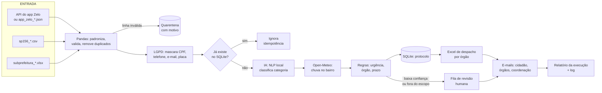

# Robô Zelo: triagem e despacho automático de zeladoria urbana (RPA + IA)

Projeto da Global Solution 2026.2 da FIAP (CitizenTech) para a disciplina AI for Robotic Process Automation.

O Zelo é a solução que nosso grupo desenvolveu em todas as disciplinas da GS. O app onde o cidadão
faz o relato está no repositório [gs-front](https://github.com/gabrielpalmeiraa/gs-front). Este
repositório é o robô que roda por trás: ele pega os relatos que chegaram, organiza e manda para quem
precisa resolver. Hoje esse trabalho é feito à mão por servidores da Prefeitura.

**Integrantes**

| Nome | RM |
|---|---|
| Gabriel Palmeira | 563522 |
| Mayara Mota | 563887 |

---

## 1. O problema

Rua mal conservada atrapalha mais quem anda a pé: idosos, pessoas com deficiência, quem depende de
ônibus e quem mora na periferia. No primeiro semestre de 2026, São Paulo recebeu quase 52 mil pedidos
de tapa-buraco, perto de 287 por dia
([BNews](https://www.bnewssaopaulo.com.br/noticias/politica/mesmo-apos-recapeamento-sp-registra-quase-52-mil-pedidos-de-tapa-buraco.html)).
"Buraco e pavimentação" também já foi o assunto mais reclamado na Ouvidoria Geral do Município
([relatório OGM](https://www.prefeitura.sp.gov.br/cidade/secretarias/upload/controladoria_geral/Rel_Triml_OGM-3o_trim_2023_publicacao_05_12_2023.pdf)).

Esses pedidos chegam por vários canais e cada um tem um formato: a planilha exportada do SP156, a
planilha que a subprefeitura preenche à mão e o app Zelo. Alguém tem que juntar tudo, entender o que
é cada pedido, ver o que é urgente, separar por órgão, mandar para cada equipe e avisar o cidadão.
Quando isso é feito à mão, um fio caído pode ficar na mesma fila que um pedido de poda.

Quem usa o resultado do robô:
- o cidadão que fez o relato, que recebe o número de protocolo e um prazo de referência;
- o servidor da Prefeitura, que recebe a fila já separada, ordenada por urgência e sem dados pessoais.

## 2. O que o robô faz



Passo a passo de uma execução (ninguém precisa mexer em nada no meio):

1. Busca os relatos novos do app Zelo pela API (`GET /api/v1/gestor/relatos`). Se a API não estiver
   configurada ou não responder, usa o arquivo que o app exporta.
2. Lê o CSV do SP156 e o Excel da subprefeitura e coloca tudo no mesmo formato. Depois confere linha
   por linha. Se o bairro não existe, a descrição está vazia ou a data não faz sentido, a linha vai
   para a quarentena junto com o motivo, e as outras continuam.
3. Tira CPF, telefone, e-mail e placa do texto do relato.
4. Pula o que já foi processado em outra execução (cada relato tem uma chave única no banco).
5. Um modelo de NLP que roda na própria máquina diz qual é o tipo de problema. A urgência sai de
   regras que levam em conta o texto e a previsão de chuva do bairro.
6. Salva no SQLite, gera o protocolo e monta uma planilha para cada órgão, com os casos mais urgentes
   no topo.
7. Manda os e-mails: confirmação para o cidadão (só se ele autorizou contato), a planilha para cada
   órgão (com "[CRÍTICO]" no assunto quando tem caso crítico) e um relatório para a coordenação.
8. Os casos que o robô não consegue decidir com segurança vão para `revisao_humana.xlsx`, que tem
   colunas para o servidor anotar a decisão.

## 3. Quadro de temas

Usamos 4 temas da disciplina, além da parte de IA. Tiramos qualquer um deles e o robô deixa de
entregar alguma coisa.

| Tema | Onde está no fluxo | O que resolve | Por que escolhemos |
|---|---|---|---|
| **Tratamento de arquivos e dados (Pandas)** | `zelo_robo/ingestao.py`: lê CSV (`;`, datas dd/mm/aaaa, caixa alta), Excel (`openpyxl`) e JSON; renomeia colunas para um esquema único; normaliza bairros sem acento; valida; remove duplicados; gera planilhas de saída em `relatorio.py` | Junta 3 canais com formatos diferentes num único fluxo e separa o dado ruim sem parar o robô | É o problema real de quem recebe pedidos de vários lugares: o dado chega "sujo" e em formatos que não conversam |
| **Integração com APIs** | `zelo_robo/integracoes.py`: Open-Meteo (chuva prevista por bairro) e API REST do app Zelo (relatos novos, autenticada por token no cabeçalho) | Traz contexto que muda a decisão (35 mm de chuva tornam um bueiro entupido mais urgente) e integra o robô ao app sem copiar arquivo à mão | Conecta o robô à solução única da GS e a dados abertos. A Open-Meteo é gratuita e não exige chave |
| **Banco de dados SQL (SQLite)** | `zelo_robo/banco.py`: tabelas `solicitacoes`, `envios`, `contatos`, `quarentena` e `execucoes`, com `UNIQUE` e `CHECK` | Gera protocolo, garante **idempotência** (rodar 2 vezes não duplica nada nem reenvia e-mail), guarda a fila de reenvio e o histórico de execuções | Um robô que roda todo dia precisa de memória. O SQLite não exige servidor e roda igual em qualquer máquina |
| **E-mail automatizado** | `zelo_robo/email_envio.py`: `smtplib` com STARTTLS, anexos Excel/Markdown, retry e fila de pendentes; modo "arquivo" gera `.eml` | Entrega o resultado para quem age: o órgão recebe a planilha, o cidadão recebe o protocolo, a coordenação recebe o relatório | E-mail é o canal que qualquer órgão público já usa; não exige que a equipe instale nada |
| IA (base para os temas) | `zelo_robo/classificador.py` + `zelo_robo/regras.py` | Classifica o tipo de problema (TF-IDF de palavras e de caracteres + Regressão Logística) e decide urgência com regras auditáveis | Modelo local, gratuito e sem LLM: nenhum texto de cidadão sai da máquina. A probabilidade do modelo decide quando chamar um humano |

Na prática, um tema depende do outro. O Pandas arruma os dados que chegam e a IA classifica. A API
traz a previsão de chuva, que entra no cálculo da urgência. O banco evita trabalho repetido e guarda
os e-mails que não foram enviados. E a planilha que o Pandas gera no fim é o anexo do e-mail que vai
para cada órgão.

## 4. Como executar

Precisa de Python 3.10 ou mais novo. Testamos com Python 3.13 no Linux e no macOS. Os comandos abaixo
são para macOS/Linux. No Windows, troque `source .venv/bin/activate` por `.venv\Scripts\activate`.

```bash
git clone https://github.com/gabrielpalmeiraa/gs-rpa.git
cd gs-rpa
python3 -m venv .venv
source .venv/bin/activate
pip install -r requirements.txt
cp .env.example .env          # funciona sem editar nada (e-mail em modo "arquivo")

python main.py --resetar --demo
```

O `--demo` cria um lote de exemplo em `entrada/`, já com alguns erros colocados de propósito, e o
robô processa tudo. No fim ele mostra um resumo no terminal e salva os resultados em
`saida/<data-hora>/`:

| Arquivo | Conteúdo |
|---|---|
| `relatorio_execucao.md` / `.json` | números da execução, integrações, quarentena, revisão, e-mails, alertas |
| `despachos/despacho_<órgão>.xlsx` | lista de cada órgão, ordenada por urgência, com a justificativa de cada uma |
| `revisao_humana.xlsx` | o que o robô não decidiu sozinho, com colunas para o servidor preencher |
| `quarentena.csv` | linhas rejeitadas e o motivo |
| `outbox/*.eml` | todos os e-mails gerados (abrem no Mail/Outlook com os anexos) |
| `logs/robo.log` | log completo de todas as execuções, sem dados pessoais |

Deixamos um exemplo de cada um desses arquivos em [`docs/exemplo_saida/`](docs/exemplo_saida/).

Outros comandos:

```bash
python main.py                           # processa o que estiver em entrada/ (uso diário)
python main.py --demo                    # roda de novo o mesmo lote: mostra a idempotência (0 novos)
python main.py --resetar --demo --simular-falha api smtp arquivo   # demonstra o tratamento de falhas
python -m scripts.validar                # gera docs/evidencias/resultado_validacao.md
python -m pytest -q                      # 17 testes automatizados
python -m scripts.gerar_dados            # recria a base de treino e o lote de demonstração
python -m scripts.treinar_modelo         # retreina o modelo (o robô também treina sozinho se ele faltar)
```

### Configuração das chaves (`.env`)

Nenhuma senha ou token está no código. Tudo é lido do arquivo `.env`, que está no `.gitignore` e
não vai para o GitHub. Dá para rodar sem configurar nada: os e-mails viram arquivos `.eml` e os
relatos do app são lidos do arquivo JSON.

| Variável | Para que serve | Obrigatória? |
|---|---|---|
| `EMAIL_MODO` | `arquivo` (padrão) ou `smtp` | não |
| `SMTP_HOST`, `SMTP_PORTA`, `SMTP_USUARIO`, `SMTP_SENHA`, `SMTP_TLS` | servidor de envio | só no modo `smtp` |
| `ZELO_API_URL`, `ZELO_GESTOR_TOKEN` | API do app Zelo (ex.: `https://zelo-api-fxru.onrender.com` e o código de gestor) | não |
| `CLIMA_HABILITADO` | `0` desliga a consulta de chuva | não |

Se quiser que os e-mails sejam enviados de verdade, tem duas opções gratuitas:

- Mailtrap: crie uma conta grátis, vá em *Email Testing > Inboxes* e copie host, porta, usuário e
  senha para o `.env`, com `EMAIL_MODO=smtp`. Os e-mails caem na caixa do Mailtrap e não chegam a
  ninguém de verdade, por isso é o que recomendamos para testar.
- SMTP local, sem criar conta: num terminal rode `python -m scripts.servidores_teste` e em outro rode
  `EMAIL_MODO=smtp SMTP_HOST=127.0.0.1 SMTP_PORTA=2525 SMTP_TLS=0 python main.py --resetar --demo`.
  O primeiro terminal vai mostrando cada e-mail que chega.

## 5. Estrutura do repositório

```
main.py                      ponto de entrada (argumentos --demo, --resetar, --simular-falha)
zelo_robo/
  robo.py                    orquestra as etapas e isola as falhas
  ingestao.py                TEMA Pandas: leitura dos 3 canais, validação, quarentena
  classificador.py           IA: TF-IDF + Regressão Logística, carrega ou retreina
  regras.py                  urgência explicável, órgão, prazo, revisão humana
  integracoes.py             TEMA APIs: Open-Meteo e app Zelo, com timeout, retry e disjuntor
  banco.py                   TEMA SQL: esquema, idempotência, fila de e-mails
  email_envio.py             TEMA e-mail: SMTP ou .eml, retry, reenvio de pendentes
  relatorio.py               planilhas de despacho, revisão humana e relatório
  privacidade.py             mascaramento de dados pessoais (texto e log)
  referencia.py              bairros, subprefeituras, órgãos e prazos de referência
  config.py / log.py         configuração pelo .env e log em arquivo
scripts/                     geração de dados, treino, validação e servidores locais de teste
dados/treino/                880 relatos sintéticos rotulados (base de treino)
dados/teste/                 relatos escritos à mão: conjunto de desenvolvimento e conjunto de teste
docs/evidencias/             resultado da validação (gerado pelo scripts/validar.py)
docs/exemplo_saida/          exemplo real de relatório, planilhas e e-mails
tests/                       testes automatizados (pytest)
demo_colab.ipynb             a mesma execução em notebook, para rodar no Google Colab
```

## 6. Resiliência e segurança

| Falha previsível | O que o robô faz | Onde |
|---|---|---|
| Arquivo ausente num canal | avisa no log e no relatório e segue com os outros canais | `ingestao.ingerir` |
| Arquivo corrompido ou sem as colunas esperadas | rejeita só aquele arquivo, move para `entrada/com_erro/` e segue | `ingestao.ArquivoInvalido` |
| Linha com dado inválido | vai para a quarentena com o motivo (tabela, CSV e relatório) | `ingestao.validar` |
| Mesmo relato duas vezes no lote | descarta a cópia | `ingestao.validar` |
| Mesmo lote processado de novo | nada é duplicado e nenhum e-mail é reenviado (chave `UNIQUE`) | `banco.py`, `Carteiro.enviar` |
| API fora do ar ou lenta | timeout e até 3 tentativas, com espera crescente entre elas (1 s, depois 2 s); depois segue sem o dado. Erros 4xx não são repetidos. Depois de 2 bairros sem resposta o disjuntor para de tentar na execução | `integracoes.com_retry` |
| API do app Zelo indisponível | usa o arquivo exportado do app | `robo.executar` |
| Servidor de e-mail fora do ar | 3 tentativas; se falhar, guarda o `.eml` como pendente e reenvia na próxima execução | `email_envio.py` |
| Senha SMTP errada | não insiste (evita bloqueio da conta), registra e deixa pendente | `email_envio._entregar` |
| Arquivo do modelo de IA apagado ou corrompido | retreina automaticamente a partir da base | `Classificador.carregar_ou_treinar` |
| Erro inesperado em um relato | registra o erro e continua com os outros | `robo.executar` |
| Caso que o robô não deve decidir sozinho | fila de revisão humana (confiança abaixo de 55% ou fora do escopo) | `regras.decidir` |
| Caso **crítico** com baixa confiança | despachado mesmo assim **e** marcado para revisão: segurança antes da fila | `robo.executar` |

Toda execução gera um relatório, uma linha na tabela `execucoes` e registros no `logs/robo.log`. No
fim, o status fica como `concluido`, `concluido_com_alertas` ou `falhou`.

## 7. Evidências de validação

Dá para reproduzir tudo desta seção rodando `python -m scripts.validar`. O script gera o arquivo
[`docs/evidencias/resultado_validacao.md`](docs/evidencias/resultado_validacao.md), com as tabelas
completas, a matriz de confusão, a lista de todos os erros e trechos do log de cada cenário.

### 7.1 Como medimos

Usamos três conjuntos de dados:

- Treino: 880 relatos sintéticos, montados combinando trechos de frases (`scripts/gerar_dados.py`,
  com semente fixa para sempre gerar o mesmo arquivo).
- Desenvolvimento: 72 relatos que escrevemos à mão. Usamos esse conjunto para achar os erros da
  primeira versão das regras e corrigir.
- Teste: 64 relatos novos, 8 de cada categoria. Escrevemos esses só depois de terminar o modelo e as
  regras, e não mudamos nada depois de ver o resultado. Nenhuma frase do teste aparece no treino.
  Os números que importam são os deste conjunto.

### 7.2 Resultado no conjunto de teste (64 relatos)

| O que foi medido | Resultado |
|---|---|
| Categoria certa (acurácia) | **87,5%** (56 de 64), F1 macro 0,871 |
| Enviados para revisão humana | 17 (27%) |
| Categoria certa entre os decididos sozinhos pelo robô | **91,5%** (43 de 47) |
| Erros de categoria que caíram na revisão humana | 4 de 8 |
| Urgência exata | 67,2% (43 de 64) |
| Urgência com até 1 nível de diferença | 95,3% (61 de 64) |
| Casos críticos reconhecidos como críticos | **4 de 8** |
| Falsos críticos | 0 |

Na primeira versão das regras, o conjunto de desenvolvimento dava 61,1% de acerto na urgência e só 5
dos 8 críticos eram detectados. Corrigimos as regras e o mesmo conjunto subiu para 90,3% e 8 de 8.
No conjunto de teste, porém, caiu para 67,2% e 4 de 8. Ou seja, parte da melhora foi só porque
ajustamos as regras em cima daqueles exemplos. Foi exatamente para enxergar isso que separamos
desenvolvimento e teste.

### 7.3 Análise dos erros

Categoria: o modelo errou 8 relatos. Quatro deles tinham confiança baixa e foram para a revisão
humana. Os outros quatro passaram direto:

- Dois misturam assuntos de verdade. "Buraco perto da faixa de pedestre" foi classificado como
  sinalização, com 86% de confiança, e "árvore bloqueando a placa de pare" também virou sinalização.
  Quando aparece uma palavra muito ligada a outra categoria, o modelo vai nela e ainda fica confiante.
- Os outros dois, "rua de terra virou lama" e "academia ao ar livre enferrujada", usam palavras que
  não existem na base de treino.

Urgência: foram 21 erros. Em 11 deles o relato era de baixo impacto e o robô marcou como média.
Esse erro não preocupa muito, porque o caso só ganha um prazo menor do que precisava. O que preocupa
são os 8 casos em que a urgência ficou abaixo do certo, e 4 deles eram críticos:

- "caixa de luz aberta com os fios aparecendo";
- "chão afundou e dá pra ver o cano";
- "córrego subindo com gente atravessando a ponte";
- "galho rachou e está quase caindo" (esse ficou como alta).

As regras reconhecem as palavras que estão nelas, como "fio caído", "cratera" e "ilhado". Se a
pessoa descreve o mesmo perigo com outras palavras, a regra não pega.

### 7.4 Limites da solução

- A urgência calculada por regras é fácil de auditar, mas não cobre todo jeito de escrever. Por isso
  o robô não é a única proteção: todo e-mail para o cidadão diz para ligar na Defesa Civil (199) ou
  nos Bombeiros (193) se houver risco imediato, e os relatos que vêm do app já chegam com a urgência
  confirmada pelo próprio cidadão.
- Os dados são sintéticos e o conjunto de teste é pequeno (64 relatos, rotulados por nós mesmos). Os
  números dão uma ideia de como o robô se comporta, mas não dizem como ele iria em produção.
- A confiança do modelo nem sempre é confiável. Com palavras fortes de outra categoria, ele erra
  achando que acertou, e esses casos não vão para a revisão humana.
- A previsão de chuva é do centro do distrito, não da rua exata do relato.

O que faríamos em seguida: treinar um segundo modelo só para a urgência, usando como rótulo as
urgências que os cidadãos confirmam no app; mandar para revisão humana todo relato que tenha palavra
de perigo e não tenha chegado em "alta"; e chamar o LLM do app como segunda opinião nos casos de
baixa confiança, sempre com o texto já anonimizado.

### 7.5 Cenários ponta a ponta e casos de falha

Cada cenário roda o robô inteiro numa pasta temporária. Os 10 passaram:

| # | Cenário | Resultado observado |
|---|---|---|
| 1 | Execução normal do lote (3 canais, 22 linhas) | 16 protocolos, 5 em quarentena, 1 duplicado descartado, 3 para revisão, 1 relato com CPF e telefone removidos, 17 e-mails |
| 2 | O mesmo lote chega de novo | 0 novos, 16 ignorados, nenhum e-mail repetido |
| 3 | Excel corrompido + CSV sem as colunas | os 2 rejeitados e movidos para `com_erro/`; os outros geraram os 16 protocolos |
| 4 | Pasta de entrada vazia | aviso para os 3 canais, relatório gerado, sem erro |
| 5 | API do app e Open-Meteo fora do ar | 3 tentativas, disjuntor abriu, leu o arquivo do app, 16 protocolos sem o dado de chuva |
| 6 | Open-Meteo devolve 503 duas vezes e depois 35 mm | o retry recuperou; 3 alagamentos/árvores subiram de urgência pela chuva |
| 7 | Servidor de e-mail fora do ar | 17 e-mails pendentes guardados; execução terminou normalmente |
| 8 | Servidor de e-mail volta | os 17 pendentes + o relatório novo entregues, sem duplicar |
| 9 | Modelo de IA corrompido | detectou, retreinou e seguiu |
| 10 | Procura de CPF, telefone e e-mail do lote no log | nada encontrado |

## 8. Proteção de dados, ética e ODS

**Proteção de dados.** Seguimos o princípio da necessidade da LGPD (art. 6º, III): o texto do relato
é anonimizado antes de ser classificado, salvo no banco ou colocado em planilha ou e-mail, e o texto
original não fica guardado. O e-mail do cidadão só é usado se ele autorizou o contato (art. 7º, I).
Ele fica numa tabela separada e é apagado assim que a confirmação é enviada (art. 16). No log, os
e-mails aparecem mascarados, e um filtro remove CPF e telefone de qualquer mensagem. Como a
classificação roda na própria máquina, nenhum relato é enviado para API externa. A Open-Meteo só
recebe a coordenada do centro do bairro. Senhas e tokens ficam no `.env`, fora do repositório. Todos
os dados do projeto são sintéticos, e os e-mails usam o domínio `example.com`, que é reservado para
testes.

**Ética.** Nos casos difíceis, quem decide é uma pessoa: relatos com baixa confiança ou fora do
escopo vão para um servidor. Cada urgência vem com o motivo escrito, então dá para discordar da
decisão e saber por quê. Um risco que nos preocupou foi o viés de linguagem. Quem escreve com gíria,
com erro de digitação ou com poucas palavras (o que é mais comum entre pessoas com menos acesso à
educação) poderia ter o relato mal classificado. Para diminuir isso, o modelo também olha pedaços de
palavras, então entende "burako" e "calsada", e a urgência sobe quando o relato fala de idosos,
crianças, pessoas com deficiência, escola ou UBS. Outro risco é a automação esconder os próprios
erros. Por isso o relatório mostra quantos casos foram para revisão, e este README mostra os erros
que medimos, inclusive os casos críticos que o robô não pegou.

**ODS.** O projeto se liga a três ODS:
- ODS 11, meta 11.7 (espaços públicos seguros, inclusivos e acessíveis): calçada sem rampa, rua
  escura e buraco, que colocam o pedestre em risco, vão para o topo da fila.
- ODS 3, meta 3.6 (reduzir mortes e ferimentos no trânsito): semáforo apagado, faixa apagada e
  buraco onde moto já caiu ganham prioridade.
- ODS 16, meta 16.6 (instituições eficazes e transparentes): o cidadão recebe protocolo e prazo, e
  cada decisão do robô fica registrada com o motivo.

## 9. Ferramentas

Python, Pandas, openpyxl, scikit-learn, requests, smtplib, SQLite e a API pública Open-Meteo. Todas
são gratuitas, e o robô não usa LLM.
